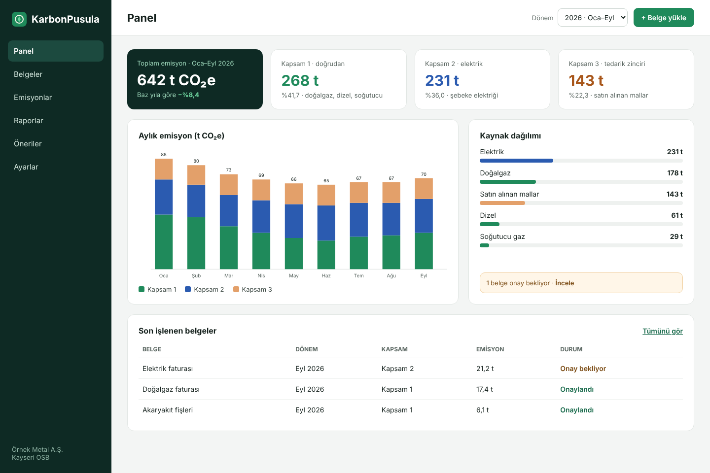
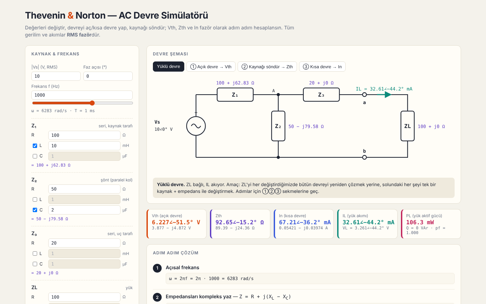
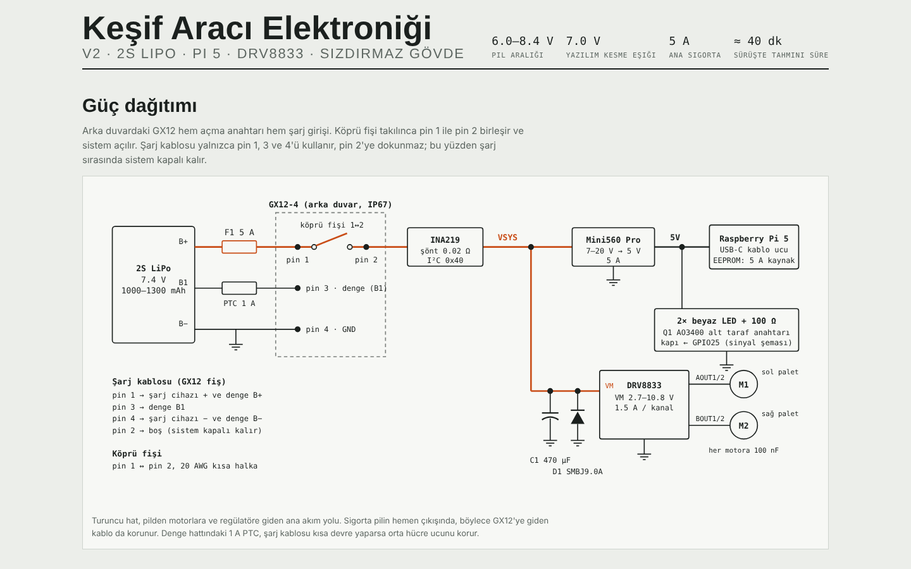

<h1 align="center">Hi, I'm Enes Erdoğan 👋</h1>

  Electrical & Electronics student at Abdullah Gül University, Kayseri 
  Robotics · Embedded systems · AI · Founder & team captain of <b>Sumer Technology</b>

  
  
  

---

### About me

- 🎓 4th-year Computer Engineering student, Electrical & Electronics Engineering background (AGÜ)
- 🤖 I build robots and the software that runs them: tracked rovers, an AGV that carries 200 kg, a quadruped robot dog
- 🧠 I like connecting AI with hardware — computer vision on Raspberry Pi, local LLMs, ML models
- 🌱 With my team I built **KarbonPusula**, an AI carbon reporting app for SMEs — **3rd place at COP31 Climate Technologies Creathon**
- 🥉 3rd place at **TOMTAŞ**
- 👨‍🏫 Mentor and project advisor at **DENEYAP Technology Workshops** (T3 Foundation)

### Tech I use

**Languages:** Python · C / C++ · ARM Assembly · JavaScript · MATLAB
**Embedded & robotics:** STM32 · Arduino · ESP32 · Raspberry Pi · ROS 2 · LiDAR
**AI / ML:** PyTorch · TensorFlow / Keras · scikit-learn · XGBoost · OpenCV · RAG / LLMs
**Tools:** Git · Docker · Linux · Keil µVision · 3D printing (Bambu Lab)

---

### ⭐ Featured projects

| Project | What it is |
|---|---|
| 🌱 [**KarbonPusula**](https://github.com/EnesErdogans/KarbonPusula-Showcase) | AI-assisted carbon inventory & CBAM reporting for SMEs — COP31 Creathon 3rd place *(showcase)* |
| 📚 [**Local-RAG-Assistant**](https://github.com/EnesErdogans/Local-RAG-Assistant) | Offline document Q&A with Foundry Local, SQLite vector search and Streamlit |
| 🏠 [**House Price Prediction**](https://github.com/EnesErdogans/COMP468-) | Stacked ensemble + Optuna — Kaggle top 0.3 % (226 / 70,000+) |
| 🎯 [**Color-Track Pan-Tilt Camera**](https://github.com/EnesErdogans/color-track-pan-tilt-camera) | OpenCV color tracking with a Flask web UI and Arduino servos |
| ⚡ [**Thevenin & Norton AC Simulator**](https://github.com/EnesErdogans/thevenin-norton-ac-simulator) | Interactive step-by-step AC circuit solver — [live demo](https://eneserdogans.github.io/demos/thevenin/) |
| 🛰️ [**Keşif Aracı**](https://github.com/EnesErdogans/kesif-araci) | Sealed, invertible tracked recon robot on Raspberry Pi 5 |
| 🚗 [**Smart Parking Barrier**](https://github.com/EnesErdogans/Smart_parking_barrier_project) | RFID-controlled EV parking barrier on STM32F407 (register-level) |
| 🔴 [**DIY Laser XY Scanner**](https://github.com/EnesErdogans/DIY-Laser-XY-Scanner) | Arduino + stepper mirrors drawing shapes with a laser |
| 🩺 [**Electronic Stethoscope**](https://github.com/EnesErdogans/Electronic-Stethoscope-2024-) | Heart & lung sound filtering, BPM / RPM with FFT (Arduino + MATLAB) |

  
  
  

---

### 📫 Contact

Email: [enes.erdogan@agu.edu.tr](mailto:enes.erdogan@agu.edu.tr) · LinkedIn: [eeneserdogan](https://www.linkedin.com/in/eeneserdogan/)
